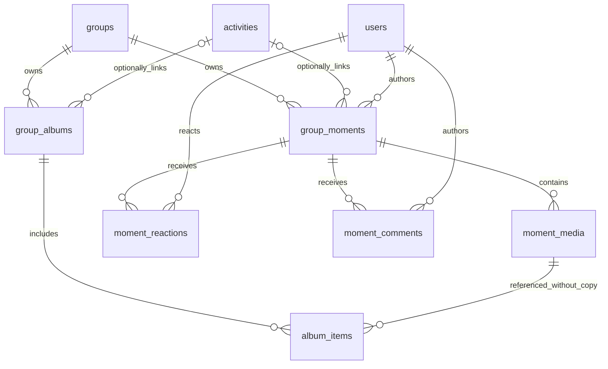
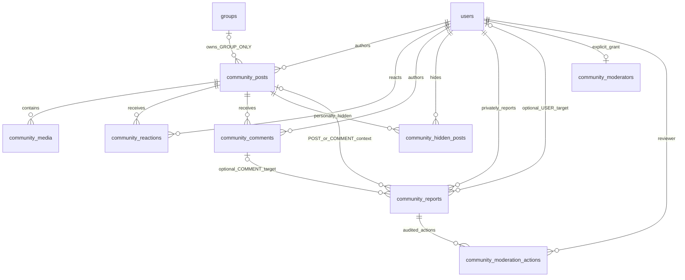
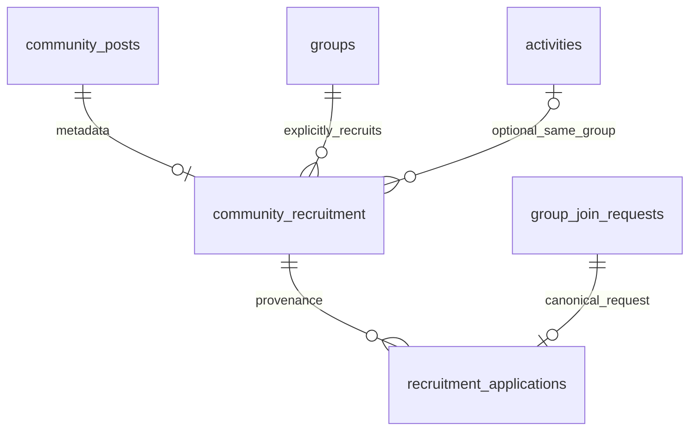

# ERD & DATABASE DESIGN v1.0

## 1. Technology & Principles
Primary DB: PostgreSQL.
Schema management: Flyway.

Identifiers:
- UUID
- UUIDv7 recommended if convenient
- UUIDv4 acceptable

Types:
- CITEXT for username/email
- TIMESTAMPTZ
- NUMERIC(19,2) for money

Principles:
- Facts persisted.
- Summaries derived.
- Important history preserved.
- Financial rows avoid hard delete.
- Redis stores ephemeral state.
- Files live in object storage; DB stores metadata/reference.

## 2. Identity & Auth
Tables:
- users
- user_credentials
- user_privacy_settings
- auth_tokens
- refresh_sessions
- user_devices

`refresh_sessions` supports refresh-token rotation/revocation.

Suggested fields:
- id
- user_id
- token_hash
- expires_at
- revoked_at
- replaced_by_session_id
- device_name/platform optional
- created_at

`user_devices` supports FCM:
- id
- user_id
- platform
- push_token
- device_id
- active
- last_seen_at
- created_at
- updated_at

## 3. Social
- friend_requests
- friendships
- user_blocks
- user_presence_snapshots

Realtime presence itself belongs Redis.

## 4. Group
- groups
- group_settings
- group_memberships
- group_invitations
- group_invite_links
- group_join_requests
- group_bans
- group_activity_logs

Important:
- membership history retained
- rejoin creates new row
- one active membership/user/group

## 5. Chat
- conversations
- direct_conversations
- group_conversations
- message_requests
- conversation_sequences
- messages
- message_attachments
- message_edit_history
- message_hidden_users
- message_reactions
- conversation_read_states
- message_pins

### V4 as-built Chat persistence (used by M9 REST)

R3 additive V13 extends the final current schema: `polls.group_id` is a required group FK, backfilled from existing Activities; `polls.activity_id` becomes optional. A database trigger fills group ownership for legacy Activity-only inserts and rejects a cross-group Activity association. Existing options/ballots/choices are unchanged. Group history indexes `(group_id, created_at DESC)`; Activity history retains its existing index and identity. `messages.poll_id` is a nullable FK to the canonical Poll (`ON DELETE RESTRICT`); TEXT/IMAGE rows retain null references. V14 permits original POLL plus POLL_VOTED/POLL_VOTE_CHANGED references, with a partial unique index retaining exactly one original POLL card. Vote activity rows use ordinary sender/sequence/content fields, not a second Poll. `poll_vote_commands` stores only `(poll_id,user_id,request_id,created_at)` receipts (composite PK, Poll/user FKs) to prevent delayed request replay; canonical ballots/selections remain in existing tables. No hidden Activity or implicit hard-delete of linked history. Group/Activity UI lifecycle remains non-destructive; a hard deletion of a referenced Poll is deliberately restricted.

V4 already provides all Chat persistence tables; M9 does not need a migration.
`conversations` is the root (`DIRECT` or `GROUP`) with subtype rows in
`direct_conversations` (canonical, unique user pair) and
`group_conversations` (unique group). `conversation_sequences` stores the
monotonic sequence. `messages` stores sender, TEXT/IMAGE/POLL/POLL_VOTED/POLL_VOTE_CHANGED type, optional reply,
active/unsent status, edit/unsend timestamps and unique `(conversation_id,
sequence)`. `message_requests` supports PENDING/ACCEPTED/DECLINED/CANCELLED,
with at most one pending request per conversation. `message_attachments`,
`message_edit_history`, `message_hidden_users`, `message_reactions`,
`conversation_read_states`, and `message_pins` support their respective
features and FK cascades. Reactions are unique per message/user; read state is
one monotonic last-read sequence per conversation/user. M9 exposes text REST
send. The V4 attachment table is reserved schema support; upload, storage
ownership, and runtime rendering are deferred beyond M9. No raw storage key is
accepted from clients.

## 6. Activity
- activities
- activity_participants
- activity_rsvp_history
- activity_waitlist_sequences
- activity_status_history
- activity_change_logs

### M7 activity persistence and V12 schedule rule
`activities.start_at`, `activities.end_at`, and `activities.timezone` are nullable in PostgreSQL after `V12__unscheduled_activities.sql`.

- Unscheduled row: all three fields are `NULL`.
- Scheduled row: `start_at` and `timezone` are non-null; `end_at` is optional and, when present, must be later than `start_at`.
- `activity_participants` records each member's server-assigned participation status and optional FIFO `waitlist_sequence`; `activity_waitlist_sequences` provides the per-activity monotonic sequence.
- `activity_status_history` and `activity_change_logs` retain lifecycle and confirmed-schedule changes.
- `group_activity_logs` records group-visible Activity lifecycle audit actions.
- Group avatar storage is a nullable `groups.avatar_storage_key`; its binary remains outside PostgreSQL.

## 7. Poll
- polls
- poll_options
- poll_votes
- poll_vote_choices

As-built M8 schema (V6): `polls` belongs to an Activity and stores creator,
question, `poll_type`, option-addition setting, optional selection limit,
vote/result visibility, open/closed state, `deadline_at`, and closure audit
timestamps/actor. `poll_options` stores ordered text and disabled state;
`poll_votes` stores one ballot per user/Poll; `poll_vote_choices` links each
ballot to its selected options. V6 enforces the Poll/user and vote/option
uniques and cascades Poll deletion through options, votes, and choices. The
consumer M8 UI creates SINGLE-choice Polls; MULTIPLE-choice remains in the
target/current schema for backend compatibility. Anonymous Polls retain the
internal voter ID but do not expose identity through API/UI.

## 8. Task & Discussion
- tasks
- task_assignees
- task_status_history
- activity_comments

As-built M8 schema (V6): `tasks` belongs to an Activity and stores creator,
title/description, TODO/IN_PROGRESS/DONE status, and optional timestamp
`due_at`. `task_assignees` links one or more users to a Task; the unique
`(task_id, user_id)` constraint prevents duplicate assignments.
`task_status_history` stores each transition, actor, and timestamp. Deleting a
Task cascades to its assignees and status history. A passed `due_at` is not a
status transition and does not auto-complete or delete a Task.

`activity_comments` belongs to an Activity and stores a required author,
content, edit/delete audit fields, and nullable `parent_comment_id` for one
reply level (depth is enforced by the service). Deleting an Activity cascades
to its comments; deleting a parent comment cascades to its replies. Comment
author deletion is restricted; the moderator/deleter reference is set null.
These are the existing V6 tables; M8 requires no new migration.

## 9. Calendar
- user_activity_reminders

Calendar is derived from Activity; no duplicate calendar event table required in MVP.

## 10. Finance
- expenses
- expense_shares
- expense_change_logs
- settlements
- settlement_status_history

No authoritative `debts` table.
Debt is derived from Expense facts and COMPLETED settlements.

M11 runtime reuses the existing V7 finance schema; it adds no migration or
table. ACTIVE expenses and their shares are the source facts, completed
settlements reduce pairwise obligations, and pending settlements reserve
obligations against expense edits/cancellation. Expense cancellation is a
status transition so audit/history rows remain. M11 supports EQUAL and
CUSTOM_AMOUNT splits with NUMERIC(19,2); settlement actions remain M12 scope.
Receipt storage/upload is not implemented and does not add a receipt field to
the as-built API projection.

## 11. Group Fund
- group_funds
- fund_managers
- fund_collections
- fund_collection_obligations
- fund_contributions
- fund_expenses
- fund_reimbursements
- fund_transactions
- fund_transaction_reversals

Fund balance derived from ledger.

## 12. Notification
- notifications
- user_notification_settings
- group_notification_settings
- user_devices

## 13. Important FK / Integrity Rules
- Membership → Group/User
- Activity → Group
- Poll/Task/Comment → Activity
- Expense → Group
- Expense.activity_id nullable but must reference same Group
- Settlement history remains resolvable after member leaves
- Fund entities → Group/Fund
- Financial/history records avoid cascade hard-delete

## 14. Important Constraints
- username unique
- email unique
- one ACTIVE membership/user/group
- one reaction/user/message
- one group conversation/group
- one active fund/group MVP
- amount fields > 0 where applicable
- custom expense shares sum = total
- fund balance cannot go negative
- settlement amount <= current debt

## 15. Index Strategy
Important indexes:
- users(username)
- users(email)
- group_memberships(group_id, user_id, status)
- activities(group_id, start_at)
- messages(conversation_id, sequence)
- notifications(user_id, read_at, created_at)
- expenses(group_id, occurred_at)
- settlements(group_id, status)
- fund_transactions(fund_id, created_at)

## 16. Flyway Plan
```text
V1__identity_and_auth.sql
V2__social.sql
V3__groups.sql
V4__chat.sql
V5__activities.sql
V6__poll_task_discussion.sql
V7__finance.sql
V8__group_fund.sql
V9__notifications_reminders.sql
V10__cross_module_indexes.sql
V12__unscheduled_activities.sql
```

Rules:
- Applied migration is immutable.
- Schema change after release uses V11, V12, ...
- Hibernate uses `ddl-auto=validate`.

## 17. PostgreSQL vs Redis

PostgreSQL:
- User
- Group
- Message
- Activity
- Expense
- Settlement
- Fund
- Notification
- `user_presence_snapshots` (`user_id`, `last_seen_at`): Durable last-seen snapshot updated by M10 (`ChatService.recordLastSeenSnapshot`) when a user's last active WebSocket session closes.

Redis (M10 Chat Realtime):
- Pub/Sub Fanout Channel: `wedo:chat:realtime` (`RedisEnvelope` with `eventId` deduplication)
- Multi-Session Presence Set: `presence:user:{userId}:sessions` (`120s` TTL)
- Ephemeral Typing Key: `typing:{conversationId}:{userId}` (`5s` TTL)
- Rate limit
- Temporary WebSocket/session state
- TTL-based ephemeral data

## 18. File Storage
Do not store binary media in PostgreSQL.

DB stores:
- storage key
- content type
- size
- metadata
- business relation

Binary stored in:
- S3-compatible storage / Cloudinary

## R4 current schema — private group memories (Flyway V15)

These are implemented tables, distinct from public Community content. V15 is
additive to V1–V14; current QA V15 is applied. Existing rows/objects are retained.

| Table | Persisted columns and invariants |
|---|---|
| `group_moments` | UUID PK/client command; group FK NOT NULL; optional Activity FK; author FK; caption VARCHAR(5000); created/updated TIMESTAMPTZ; nullable deleted_at/deleted_by audit |
| `moment_media` | UUID PK; Moment FK; unique storage_key; content_type, file_name, positive BIGINT size; nonnegative sort_order unique within Moment |
| `moment_reactions` | Composite PK(moment,user); one of existing six emoji |
| `moment_comments` | UUID PK/client command; Moment/author FKs; nonblank content VARCHAR(2000); created_at; soft-delete audit |
| `group_albums` | UUID PK/client command; group FK; optional Activity FK; author; nonblank name VARCHAR(160), description VARCHAR(2000); created/updated and soft-delete audit |
| `album_items` | Composite PK(album,media); media FK to existing moment_media; added_by/added_at; no object copy |

Triggers enforce same-group optional Activity and album/media links. Partial
group/Activity `(created_at DESC,id DESC)` indexes support live feed; comments
and albums have corresponding cursor indexes. Album grids use stable media UUID
cursor. Service reads require current membership and filter soft-deleted content.
No cascade object deletion: deleting an album removes its visibility, not source
Moments or shared bytes. Moment deletion hides its references from album reads.
Private orphan PUT objects are retained pending an explicit future retention
policy; failed database writes cannot commit incomplete references.



See [R4 delivery](R4_MOMENTS_ALBUM_DELIVERY.md) for actual API, permission matrix,
media constraints and the60-second previously issued signed-URL revocation limit.

## R5 current schema — Community Core (Flyway V16)

Independent of private group Moments; no implicit Activity or second media store.
V16 tested on isolated PostgreSQL and applied successfully to QA; forward-only.

| Table | Current schema/invariants |
|---|---|
| `community_posts` | UUID PK/client command, author FK; post_type GENERAL (R6 extension requires forward migration); caption5000; visibility PUBLIC/FRIENDS_OF_FRIENDS/FRIENDS/GROUP_ONLY; group FK iff GROUP_ONLY; ACTIVE/REMOVED moderation_status; created/updated/deleted_at/deleted_by |
| `community_media` | UUID PK; post FK; unique private storage key; MIME/file name/positive size; sort order unique per post |
| `community_reactions` | PK(post,user); one existing supported emoji |
| `community_comments` | UUID PK/client command; post/author FKs; nonblank2000 text; created_at; deletion audit |
| `community_hidden_posts` | PK(post,user), created_at; personal exclusion |
| `community_reports` | UUID PK; private reporter FK; POST/COMMENT/USER target, nullable post/user/comment FKs with exclusive target CHECK; same-post comment trigger; reason including SCAM/INAPPROPRIATE_CONTENT; OPEN/REVIEWED/DISMISSED; captured minimal evidence; unique OPEN(reporter,type,target), queue cursor index |
| `community_moderators` | user_id PK/FK; granted_at/by FK, revoked_at; explicit global grant, never inferred from group role |
| `community_moderation_actions` | UUID command PK, report/moderator FKs; DISMISS/RESOLVE/REMOVE/RESTORE; nonblank reason≤1000; before/after status, created_at; indexed report history |

Live reverse-time feed, author and group indexes; cursor comment index. One
post store for all visibility modes. Current ACTIVE friendships and two-hop graph,
bidirectional user blocks, active group membership and nonrevoked bans determine
eligibility at read time, not cached eligibility rows. Exclude before pagination.
Group ownership validated server-side, not merely a supplied UUID. Reports do not
automatically remove content; global workflow deferred to R7. Soft deletion retains
shared object bytes; no destructive cleanup/cascade file deletion introduced.



See [R5 contract/privacy evidence](R5_COMMUNITY_CORE_DELIVERY.md).

## R6 additive V17 — recruitment provenance

Applied after unchanged V13–V16; never rewrite applied migrations. Extends only
canonical `community_posts.post_type` CHECK to GENERAL/LOOKING_FOR_MEMBERS;
visibility/group ownership constraint remains intact.

| Table | Persisted facts |
| --- | --- |
| community_recruitment | post_id PK/FK CommunityPost; required group FK, optional Activity FK; requested_count1..100; broad_location160; tags TEXT[]≤6; planned_at; required expires_at; closed_at/closed_by FK audit; public_group_name and optional Activity title/start snapshots |
| recruitment_applications | request_id PK/FK canonical group_join_requests; post_id FK recruitment metadata; created_at; provenance only |

Indexes cover expiry/discovery, group, Activity and applications by post. SQL
triggers enforce recruitment post/group-only context, same-group Activity and
canonical request group consistency. No duplicated GroupJoinRequest or membership
state. Status, approved credits and remaining quota are projections of canonical
facts, not artificial version/status columns. Approval lock order group→metadata;
existing group admission remains exclusive membership creator. No bucket/object
changes, destructive backfill, financial schema or RSVP changes.



See [R6 contract/evidence](R6_RECRUITMENT_JOIN_DELIVERY.md).

R7 additive V18 extends the canonical Community report model above, normalizes
legacy reason and backfills minimal existing evidence; no duplicate report table.
community_comments additionally has ACTIVE/REMOVED moderation_status. Existing
post ACTIVE/REMOVED remains; restoration is an immutable action plus ACTIVE state,
not a visibility bypass. Queue index(status,reason,type,created_at,id), partial
unique OPEN target/reporter, report history index and target-context trigger.
FKs retain private reporter and moderator identity; no hard object deletion or
account-ban schema. Applied V13–V18 immutable. [R7 evidence/rules](R7_PRIVACY_MODERATION_DELIVERY.md).

**ERD & DATABASE DESIGN v1.0 — BASELINE ESTABLISHED**

## R10 additive schema — V19/V20

V19 adds `activity_stops` (Activity FK, organizer/creator User FKs, soft deletion, partial unique active order) and `activity_stop_checkins` (canonical Moment PK/FK, Stop FK, server receipt/client-declared capture metadata). Context triggers prevent cross-group/Activity associations. V20 adds `task_execution` (Task PK/FK, optional same-Activity Stop), `task_evidence` (Task/author, snapshot and partial unique PENDING), `task_evidence_media` (private keys/order), `task_evidence_reviews` (unique evidence, actor/decision/reason), and `poll_conversion_links` (source FKs SET NULL, preserved source snapshots, Activity/Group, Task/Stop target, command UUID and unique option/kind/Activity). Evidence prevents Task hard deletion; soft Stop deletion retains history. No status enum rewrite or finance changes. Both migrations tested isolated and applied QA with backup; applied V13–V20 immutable. [Exact lifecycle/evidence](R10_ACTIVITY_JOURNEY_CHECKIN_POLL_ACTION_DELIVERY.md).
